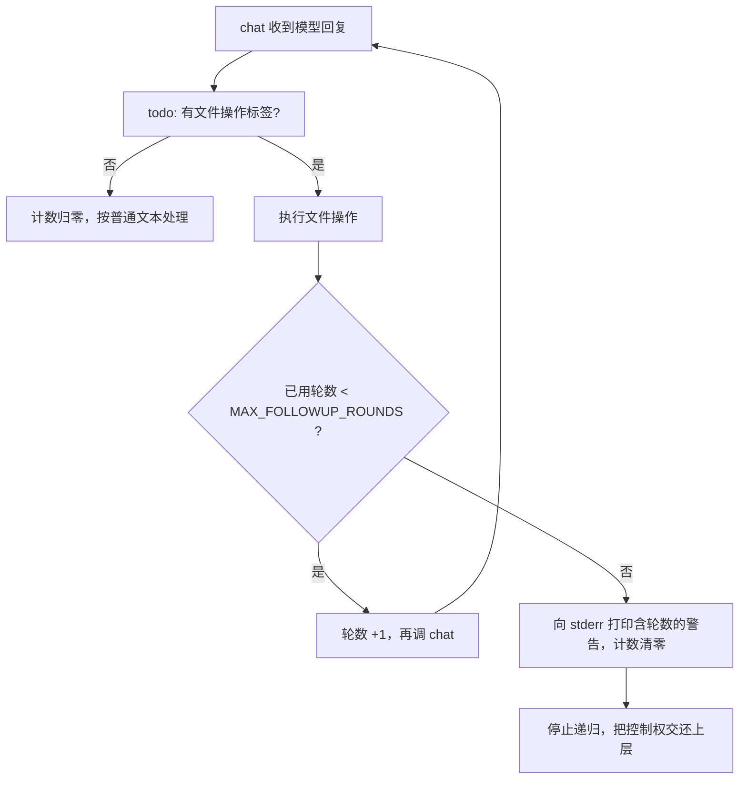

# 功能：后续对话轮数上限（todo 自递归保护）

- 功能编号：`followup-round-limit`
- 稳定文档：本文件
- 代码位置：`myagent/backend_developer_agent.py`、`myagent/frontend_developer_agent.py`、`myagent/project_manager_agent.py` 的 `reserve_followup_round()` 与 `todo()`
- 首次引入：FIX-2026-10-17-01（[修复记录](../fix/2026-10-17-todo-followup-round-limit.md)）

## 它解决什么问题

三个开发类智能体的 `todo()` 处理完文件操作后，会再调一次 `self.chat(...)`，让模型根据文件操作结果决定下一步。`chat()` 又会回调 `todo()`，形成一轮轮的「自己再调自己」。

如果模型一直返回文件操作标签（`<create_file ...>`、`<again ... />`），这个循环不会自己停。修之前它会一直递归到 `RecursionError`，异常被 `todo()` 的 `try/except` 吞掉，用户看不到原因；同时每轮都是一次真实模型调用，持续花 API 额度。

## 现在的行为

1. **上限**：类常量 `MAX_FOLLOWUP_ROUNDS = 8`（取值理由见修复记录第 2.1 节）。
2. **达到上限**：`reserve_followup_round()` 返回 `False`，`todo()` 不再调 `self.chat()`，递归立即停止；同时向 stderr 打印形如 `❌ [BackendDeveloperAgent] 已达到后续对话轮数上限 8 轮，主动停止继续调用模型。可能原因：模型持续返回文件操作指令而没有给出最终结论。` 的警告。
3. **归零**：某一轮没有文件操作标签，说明这串任务自然结束，计数归零；下一次由用户或上层发起的 `chat()` 重新获得完整的 8 轮额度。
4. **可见性**：选择打印到 stderr，而不是抛异常——抛异常会穿过 `BaseAgent.chat()` 的 except 分支触发 `on_error` 并中断上层装配流程，而客户要的是「给一条清楚的警告并交还控制权」。

## 正常路径

一轮或两轮就结束的流程，模型调用次数、stdout 输出与修复前完全一致；唯一新增的可观察输出是原本会崩溃那条路径上的 stderr 警告。

## 改动这个功能时注意

- 上限值有测试兜底（`test_round_limit_value_is_bounded` 要求 0 < 值 ≤ 20），改值要一起看 `test/business-agents/test_followup_round_limit.py`。
- 三个文件是同构实现。**不要**再新增第四份副本；统一到 `FileOperationHandler` 或抽到 `common/business-agents/` 属跨角色/需先评审的改动。
- 警告文案不要吞掉轮数信息，用户靠它判断「是不是模型在打转」。
