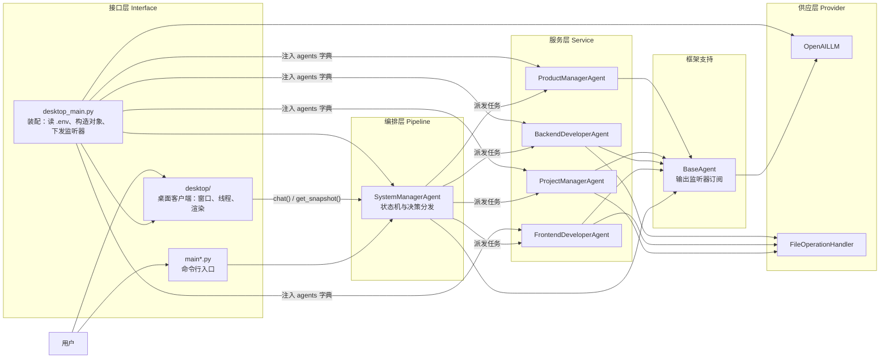
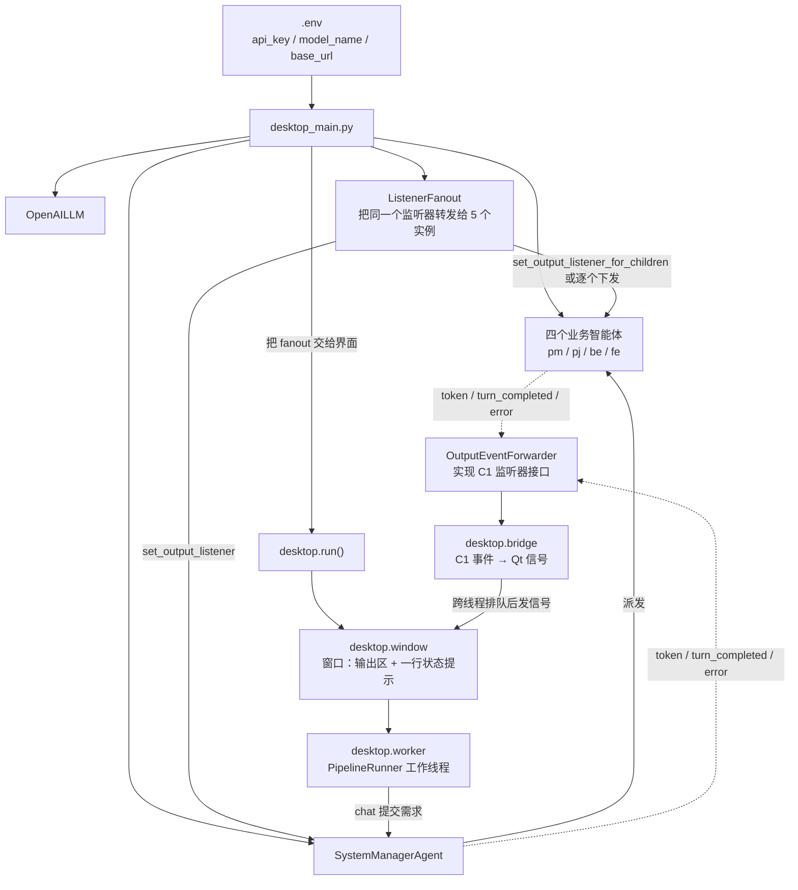

# 项目架构：代码生成助手（含桌面客户端）

- **状态**：当前有效（2026-10-17 建立）。描述的是**已经写进仓库的代码**，未实施的部分单列在「待完成」。
- **对应契约**：`docs/contracts/desktop-client-v2.md`（冻结于 2026-10-17，v1 保留可读）。
- **步骤表与进度**：`docs/workflow.md`。

## 1. 这个系统做什么

用户输入一句需求，系统让五个 AI 智能体分工：产品经理写需求文档、项目经理写开发指导、后端与前端分别产出代码、系统管理者调度顺序并维护项目状态。产出文件落在 `output/` 目录。
界面有两套：桌面窗口（PySide6）与命令行，两者共用同一批智能体与同一份 `.env`。

## 2. 五层结构与角色对应

| 架构层 | 职责 | 代码位置 | 负责角色 |
| --- | --- | --- | --- |
| Interface（接口层） | 与用户交互：桌面窗口 / 命令行入口 | `desktop_main.py`、`desktop/`、`main.py`、`main3.py`、`enhanced_main.py` | 桌面客户端（`desktop/`）、装配（`desktop_main.py` 与三个 `main*.py`） |
| Pipeline（编排层） | 项目状态机、决策分发、变更处理 | `myagent/system_manager_agent.py` | 流程编排 |
| Service（服务层） | 四个业务智能体的业务逻辑 | `myagent/` 下四个智能体文件 | 业务智能体 |
| Provider（供应层） | 模型供应商实现、文件操作子系统 | `ai_agent_factory/llms/`、`ai_agent_factory/utils/file_operation_handler.py` | 平台框架、文件产出 |
| 框架支持 | 智能体运行时基类与输出事件 | `ai_agent_factory/agent/baseagent.py` | 平台框架 |

依赖方向自上而下：接口层依赖编排层与服务层的公开入口，服务层依赖框架支持，框架支持不依赖任何上层。
**共享组件**：`common/shared/` 当前仍为空（本角色唯一写入范围），尚无跨角色共享实现。

## 3. 角色协作图

## 4. 桌面端数据流（两条路径）

用户提交需求后的完整链路分两段：**上行**是「用户的输入往下走」，**下行**是「智能体的输出往上走」。
桌面端能显示全部五个智能体的输出，靠的是下行链路里的**监听器下发**（契约 C1.2）。

读图要点：

1. **上行**：`desktop_main.py` 读 `.env` → 构造 `OpenAILLM` → 构造四个业务智能体 → 构造 `SystemManagerAgent`。
   桌面端自己不构造任何智能体，它只拿到一个「可提交、可读状态」的对象。
2. **下发**：`desktop.run()` 内部会创建监听器并调用 `set_output_listener(listener)`。
   装配层交给它的不是裸编排器，而是 `ListenerFanout`——这一刻把**同一个**监听器同时铺到编排器与四个子智能体上。
   优先走编排层的公开入口 `set_output_listener_for_children()`（C1.2 已实现，`myagent/system_manager_agent.py`）；
   该入口不可用时退回用自己持有的 `agents` 字典逐个下发，并且**打印说明了退路**，不静默降级。
3. **下行**：智能体产出 C1 事件 → `OutputEventForwarder` → `desktop.bridge` 转成 Qt 信号 → 窗口渲染。
   工作线程不直接碰控件，Qt 信号负责跨线程投递，这是界面不卡死也不崩的原因。
4. **关窗**：调用清除入口，编排器与子智能体的订阅一并取消，工作线程回收（C3）。

## 5. 关键契约索引

契约全文唯一权威处：`docs/contracts/desktop-client-v2.md`。下表只做导航，不复制条款。

| 契约 | 内容一句话 | 主负责者 | 消费者 |
| --- | --- | --- | --- |
| C1.1 | `BaseAgent` 三类输出事件（`token` / `turn_completed` / `error`）与公开订阅方法；未订阅时行为逐字不变 | 平台框架（`ai_agent_factory/agent/baseagent.py`） | 桌面客户端、装配、编排层 |
| C1.2 | 编排层把监听器下发到四个子智能体的公开入口，幂等、不静默跳过、可一并清除 | 流程编排（`myagent/system_manager_agent.py`） | 装配（`desktop_main.py` 的 `ListenerFanout`） |
| C1.3 | 桌面端如何使用：`desktop.start()` 内部订阅编排器；**下发到子智能体由装配层做**，桌面端不越层 | 桌面客户端 + 装配（分工条款） | 两个角色各自的实现 |
| C2 | `get_snapshot()` 返回 `{'state': 五布尔, 'phase': 七枚举}`，无副作用、返回副本 | 流程编排 | 桌面客户端（**界面侧尚未接入**：`desktop/` 与 `desktop_main.py` 目前都不调用它，见第 6 节） |
| C3 | 桌面端公开启动操作 `run` / `start` 与关闭句柄；`import desktop` 无副作用；启动失败清理资源 | 桌面客户端（`desktop/`） | 装配（`desktop_main.py`、`desktop/__main__.py`） |
| C4 | 依赖与启动：`PySide6==6.12.0` 精确锁定、只放运行时依赖、统一用 `.venv\Scripts\python.exe`、`.env` 共用、两种启动方式 | 装配（`requirements.txt`、`desktop_main.py`） | 全体角色与用户 |

**契约变更的后果**见 `docs/contracts/desktop-client-v2.md` 的「失效规则」与 `docs/workflow.md` 的「变更与重验」：
改 C1 或 C2 会让下游既有测试与回执作废，必须先由本角色协调、再受影响角色重跑。

## 6. 待完成 / 未验证（不要当成已完成）

| 项 | 状态 | 说明 |
| --- | --- | --- |
| 桌面端状态面板（阶段与里程碑显示） | **未实装** | C2 的 `get_snapshot()` 已实现并通过测试，但 `desktop/` 与 `desktop_main.py` 都没有调用它；窗口只有只读输出区与一行状态提示。界面侧接入属桌面客户端角色的待办 |
| S6 端到端集成验收 | **未开工** | 从输入需求到产出文件的全链路验收归「测试」角色。各角色的单元与层内测试通过 ≠ 端到端验收通过 |
| S2 完成口令 | 待补 | C1 已实现、订阅组 12 个用例在案，`S2-DONE` 口令未出 |
| 跨角色重复实现 | 待治理 | 三个业务智能体各自重复实现了 `FileOperationHandler` 的文件操作方法，属跨角色集成设计，须先出设计并经客户确认 |
| `common/shared/` | 空 | 候选共享组件尚未批准实施，目录已建立但无组件 |

## 7. 相关文档

- 各角色功能导航：`角色卡/<角色>/feature-map.md`（业务功能流程图由各开发角色自己维护，本页只引用不抄写）
- 共享组件清单：`角色卡/project-management/docs/architecture/shared-components.md`
- 项目全局工程规则：`角色卡/project-management/docs/project-rules.md`
- 使用与启动说明：`README.md`
